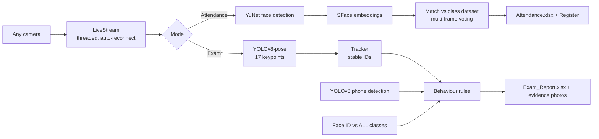

# ClassEye — Smart Attendance & Exam Monitoring

**Technovate 2.0 · 12-hour hackathon · built on 6 Nov 2026**

ClassEye turns any camera — a laptop webcam, a USB camera, a CCTV camera or a phone — into:

1. **Smart Attendance:** scans the classroom, recognises every student from the class dataset
   (USN, name, photos) and saves a formatted Excel sheet with present/absent, absentees and a running register.
2. **Exam Monitoring:** watches the whole hall and reports malpractice with photo evidence:
   mobile phone use, taking out hidden chits (pocket, waist, sleeve, shirt, under the desk),
   turning back, peeping into the front student's paper, looking at a neighbour's paper,
   and passing things. Students are identified using the photos of **all** classes, and every
   incident goes into an Excel report.

## Features

| Area | What it does |
|---|---|
| Cameras | Auto-discovers every camera on the computer (Device Manager) **and** Wi-Fi cameras on the network (phones with IP Webcam/DroidCam, RTSP CCTV). Manual address also supported. |
| Classes | Unlimited classrooms (e.g. *AIML A Section*, *AIML B Section*), each with its own dataset. Create, rename, delete. |
| Dataset | Add students (USN + name), capture face photos from the live camera, add photo files, or import a CSV/Excel list with a photo folder. A dataset check flags missing or unusable photos. |
| Attendance | Multi-frame voting, look-alike protection and one-face-one-student matching for accuracy. Excel with face photos, absentees sheet and a per-class register with attendance %. |
| Exam mode | Pose-based behaviour rules with time thresholds (a stretch or a glance is ignored), adjustable sensitivity, per-rule on/off, photo and close-up evidence, Excel incident report with a per-student summary. |

## How it works



## Run it

**Windows:** `setup.bat` once (needs internet, ~10 min), then `run.bat`.
**macOS:** `bash setup_mac.sh` once, then `source venv/bin/activate && python app.py`.
**Tests:** `python tests/test_classeye.py`
**Windows .exe:** `build_exe.bat` → `dist\ClassEye\ClassEye.exe`

Phone as camera: install **IP Webcam** (Android), press *Start server*, then *Scan for cameras*
in ClassEye or type the phone's address (e.g. `192.168.43.1:8080`).

## Project structure

```
app.py                 entry point
classeye/settings.py   paths + tunable thresholds (settings.json)
classeye/cameras.py    camera discovery (local + network) and live stream
classeye/faces.py      YuNet face detection + SFace face embeddings
classeye/classrooms.py classrooms, students, photos, face gallery
classeye/attendance.py attendance scan logic
classeye/detector.py   YOLOv8 ONNX runner (objects + pose)
classeye/tracking.py   student tracker
classeye/exam.py       malpractice rules + evidence
classeye/reports.py    Excel reports
ui/                    PySide6 desktop interface
tools/get_models.py    model download / export
tests/                 automated tests
```

## Credits

- **AI assistance:** this project was built with help from **Claude (Anthropic)**, an AI coding assistant,
  as permitted by the event mentors.
- [OpenCV](https://opencv.org) and the [OpenCV Model Zoo](https://github.com/opencv/opencv_zoo):
  YuNet face detector and SFace face recognizer
- [Ultralytics YOLOv8](https://github.com/ultralytics/ultralytics): pose and object models (exported to ONNX)
- [ONNX Runtime](https://onnxruntime.ai), [PySide6 / Qt](https://www.qt.io/qt-for-python),
  [openpyxl](https://openpyxl.readthedocs.io), [NumPy](https://numpy.org), [pygrabber](https://github.com/andreaschiavinato/python_grabber)

## Team
_Add team member names and roles here._

## Limits & next steps
- Recognition needs faces at least ~26 px wide: use one camera per ~30 students or a 1080p+ camera.
- Behaviour alerts are suspicions for an invigilator to review, not automatic penalties.
- Next: multi-camera halls, a fine-tuned model for small chits, and SMS alerts to invigilators.
